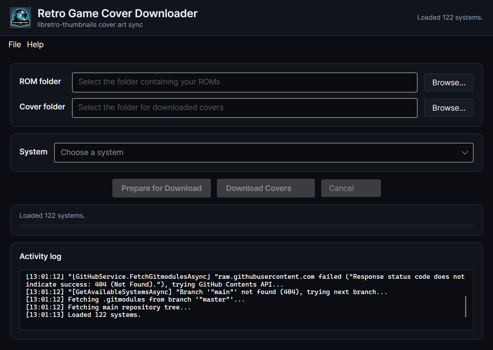

[](https://dotnet.microsoft.com/)
[](https://avaloniaui.net/)
[](https://docs.github.com/en/rest)
[](https://github.com/purelogiccode/RetroGameCoverDownloader/actions/workflows/ci.yml)
[](https://github.com/purelogiccode/RetroGameCoverDownloader/actions/workflows/docs.yml)
[](https://github.com/purelogiccode/RetroGameCoverDownloader/releases)
[](https://github.com/purelogiccode/RetroGameCoverDownloader/releases)
[](LICENSE.txt)
[](#-installation)
[](https://purelogiccode.github.io/RetroGameCoverDownloader/)
[](https://github.com/purelogiccode/RetroGameCoverDownloader/wiki)

# 🎮 Retro Game Cover Downloader

A sleek, modern cross-platform desktop application built with **Avalonia** that automatically downloads missing
cover art for your retro game ROM collection from the official
[libretro-thumbnails](https://github.com/libretro-thumbnails) GitHub repositories. Runs on **Windows, Linux,
and macOS** with x64 and arm64 builds.

## 📖 Overview

Tired of manually hunting for game cover art? **Retro Game Cover Downloader** scans your ROM folders, identifies missing covers, and fetches them directly from libretro's extensive thumbnail database. With built-in rate limit handling, progress tracking, and error reporting, managing your retro gaming library has never been easier!

## Documentation

Full documentation is published in two places:

- **Documentation site**: <https://purelogiccode.github.io/RetroGameCoverDownloader/>
- **Wiki**: <https://github.com/purelogiccode/RetroGameCoverDownloader/wiki>

The sources live in the [`docs`](docs) folder and are built and published automatically by the
[`docs` workflow](.github/workflows/docs.yml).

## ✨ Features

🎮 **Multi-System Support** - Automatically detects available gaming systems from libretro's repositories  
📁 **Smart Folder Scanning** - Scans your ROMs and existing covers to find what's missing  
⬇️ **Batch Downloading** - Downloads all missing covers in one click with progress tracking  
⚡ **Rate Limit Management** - Intelligent handling of GitHub API limits with visual countdown timer  
🔐 **Token Integration** - Optional GitHub token support for 4,900 downloads/hour (vs 55 without)  
🔑 **Auto Token Prompt** - Automatically prompts for a new token on 401 Unauthorized errors  
🔄 **Update Checker** - Automatically notifies you of new versions  
🐛 **Error Reporting** - Automatic bug reports for actionable errors; transient network failures are ignored\
⏹️ **Cancellation Support** - Cancel operations anytime  
📊 **Progress UI** - Real-time progress bar and status messages  
🖥️ **CLI Support** - Command-line arguments for automation  
🌐 **Proxy Support** - Configure HTTP proxy with host, port, and authenticated credentials  
📂 **File Extensions Configuration** - Customize which file extensions are recognized as ROM files  
🔒 **Settings Encryption** - DPAPI on Windows, AES-GCM with a user-only key file on Linux/macOS\
🔁 **Retry with Exponential Backoff** - Automatic retry on transient failures with intelligent backoff  
⚡ **Circuit Breaker** - Protects against hammering distressed servers during outages  
💾 **Systems Cache** - Caches the available systems list for faster startup and offline resilience  
🌙 **Modern UI** - Avalonia Fluent dark theme with a responsive card layout\
🖥️ **Cross-Platform** - Self-contained x64 and arm64 builds for Windows, Linux, and macOS\
📸 **Screenshot Hotkey** - Press F8 while the app is focused to capture the window

## 🖼️ Screenshots



## 📦 Installation

### Prerequisites
- **Windows 10 or later**, **Linux** (x64 or arm64), or **macOS 11 or later** (Intel or Apple silicon)
- No separate .NET runtime is required — release bundles are self-contained

### Download
1. Grab the latest release from the [Releases Page](https://github.com/purelogiccode/RetroGameCoverDownloader/releases)
2. Choose the bundle for your OS and architecture:
   - **Windows x64/arm64**: `release_<version>_win-x64.zip` or `release_<version>_win-arm64.zip`
   - **Linux x64/arm64**: `release_<version>_linux-x64.tar.gz` or `release_<version>_linux-arm64.tar.gz`
   - **macOS Intel/Apple silicon**: `release_<version>_osx-x64.tar.gz` or `release_<version>_osx-arm64.tar.gz`
3. Extract the archive and launch the application:
   - Windows: run `RetroGameCoverDownloader.exe`
   - Linux: run `./RetroGameCoverDownloader` (mark it executable if needed)
   - macOS: open `RetroGameCoverDownloader.app` (right-click → Open the first time if macOS warns
     about an unsigned app)

## 🔧 Configuration

### GitHub Token (Recommended)
To unlock the full 4,900 downloads/hour limit:

1. Go to **File → GitHub Token** in the menu bar (the token dialog also appears automatically on first launch)
2. Follow the in-app instructions or:
    - Visit [GitHub Token Settings](https://github.com/settings/tokens/new)
    - Generate a token with **`public_repo`** scope
    - Copy and paste it into the application

> **💡 Tip**: Without a token, you're limited to ~55 covers/hour. With a token, you can download thousands!

## 🚀 Usage

### GUI Mode
1. **Set ROM Folder**: Browse to your ROM collection directory
2. **Set Cover Folder**: Choose where to save cover images
3. **Select System**: Pick your gaming system (NES, SNES, Genesis, etc.)
4. **Prepare**: Scan and identify missing covers
5. **Download**: Fetch all missing covers automatically

### Command-Line Mode
```bash
# Basic usage (ROM folder first, then Cover folder)
RetroGameCoverDownloader.exe "C:\ROMs\SNES" "C:\Covers\SNES"

# With flags
RetroGameCoverDownloader.exe --cover "C:\Covers" --rom "C:\ROMs"

# Positional arguments (ROM folder first, then Cover folder)
RetroGameCoverDownloader.exe "C:\ROMs" "C:\Covers"

# Linux / macOS
./RetroGameCoverDownloader --rom "/home/me/ROMs" --cover "/home/me/Covers"
```

## 🛠️ Technical Details

### Architecture
- **Avalonia UI**: Cross-platform .NET UI with the Fluent dark theme and custom card styling
- **MVVM Pattern**: Main window uses ViewModels; dialogs use code-behind for simplicity
- **Async/Await**: Fully asynchronous operations for UI responsiveness
- **Serilog**: Structured logging with buffered UI sink, file sink, and debug output
- **Rate Limiting**: Custom `RateLimiter` service with event notifications
- **Error Handling**: Comprehensive logging and bug reporting via BugReportSink
- **Circuit Breaker**: Tracks consecutive 503 errors and triggers cooldown to avoid hammering distressed servers
- **Retry Logic**: Exponential backoff with configurable retry attempts
- **Cross-Platform**: `net10.0` application with self-contained builds for six OS/architecture targets

### Key Components
- `MainViewModel`: Core business logic and state management
- `GitHubService`: Handles all GitHub API interactions
- `BugReportService` / `BugReportSink`: Automatic error reporting via structured Serilog sink
- `SettingsManager`: JSON-based settings persistence with DPAPI (Windows) or AES-GCM (Linux/macOS)
- `RateLimiter`: Intelligent API request throttling
- `UpdateCheckerService`: Checks for new application versions
- `PlatformHelper` / `AppDialogs`: Cross-platform shell and dialog helpers

### Testing
The project includes a comprehensive test suite using **xunit**:

```bash
dotnet test
```

Tests cover models, services, helpers, converters, commands, ViewModels, and managers. CI runs the suite on
Windows, Linux, and macOS. A `MockBugReportService` is injected via `[ModuleInitializer]` to prevent real API
calls during testing.

## 🔐 Security

- GitHub tokens and proxy passwords are encrypted at rest: Windows DPAPI on Windows, AES-GCM with a
  user-only (0600) key file on Linux and macOS. They never leave your machine except to GitHub.
- Report vulnerabilities privately through [SECURITY.md](SECURITY.md). Please do not open a public issue
  for a security problem.
- The repository uses CodeQL, Dependabot alerts and security updates, secret scanning, and private
  vulnerability reporting.

## 📄 License

This project is licensed under the **GPL-3.0 license**.

## 🆘 Support

- **Issues**: [Report Bugs](https://github.com/purelogiccode/RetroGameCoverDownloader/issues)
- **Discussions**: [Ask Questions](https://github.com/purelogiccode/RetroGameCoverDownloader/discussions)
- **Security**: [Report a vulnerability privately](SECURITY.md)
- **Email**: support@purelogiccode.com

## ⭐ Show Your Support

If you find this project helpful, please consider giving it a **star** on GitHub! It helps others discover the project and motivates continued development.

[](https://github.com/purelogiccode/RetroGameCoverDownloader)

**⭐ Click the star button at the top of the repository if you like this project! ⭐**

---

<div align="center">
Made with ❤️ by <a href="https://www.purelogiccode.com">Pure Logic Code</a>
</div>